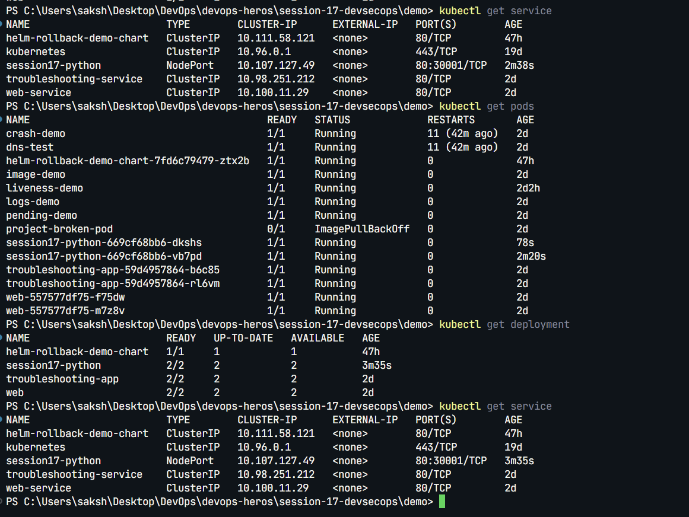
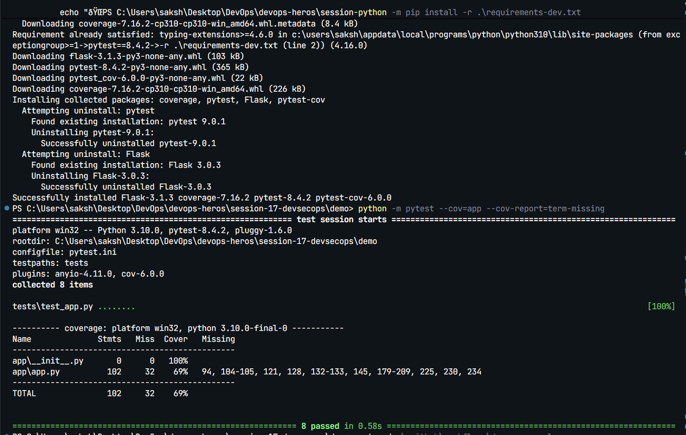
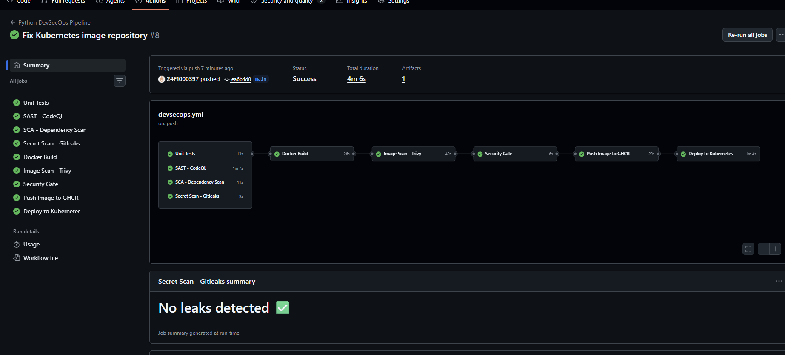

# Session 17: CI/CD and DevSecOps

## Task - DevSecOps Demo Project

Built a complete CI/CD and DevSecOps pipeline for the Flask application in `demo/`, including unit tests, Docker image build, container registry, Kubernetes deployment, and security tools.

The workflow runs tests, CodeQL SAST, pip-audit SCA, Gitleaks secret scanning, Docker build, and Trivy image scanning before the security gate allows the image to be pushed to GHCR and deployed to Kubernetes. The container runs as a non-root user, and the Deployment includes health probes and CPU/memory requests and limits.

All 8 unit tests passed. The local `session17-python:local` image returned a healthy `/health` response and was deployed to the isolated `homework-s17` namespace.

The GitHub Actions workflow and security tool configuration are in [`demo/.github/workflows/`](demo/.github/workflows/), with Kubernetes manifests in [`demo/k8s/`](demo/k8s/).
