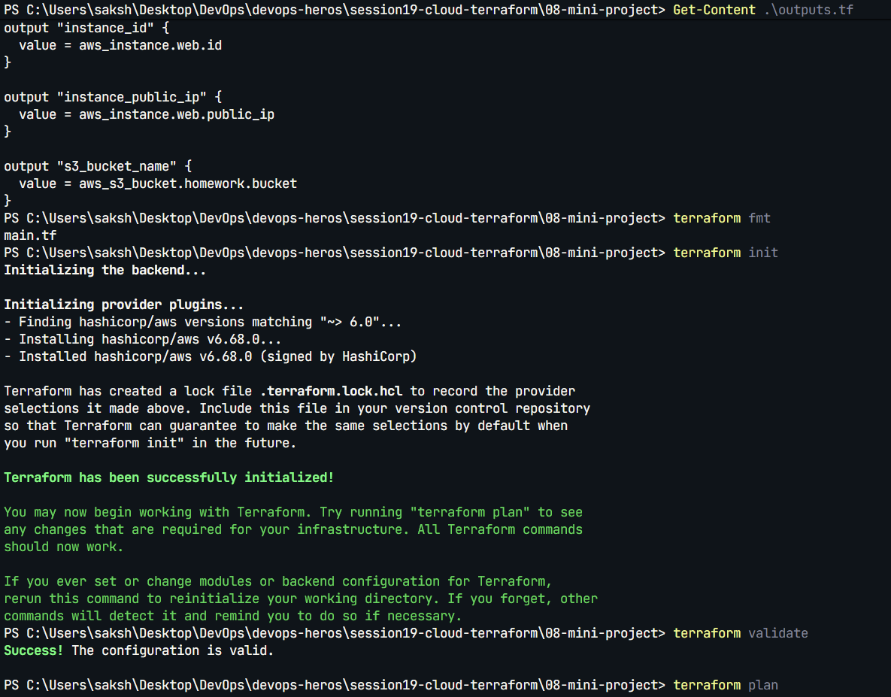
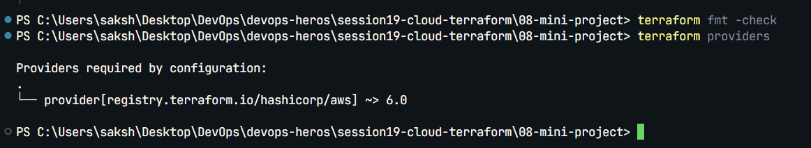

# Session 19: Cloud and Terraform in Action

## Homework project

The end-to-end Terraform project is in [`08-mini-project/`](08-mini-project/) and models:

```text
Internet
   |
Internet Gateway
   |
VPC (10.20.0.0/16)
   |
Public route table (0.0.0.0/0 -> Internet Gateway)
   |
Public subnet (10.20.1.0/24)
   |
Security group (HTTP/HTTPS) -> EC2 web server

S3 bucket (separate resource)
```

The project creates a VPC, public subnet, internet gateway, public route table and association, web security group, EC2 instance, and S3 bucket. It uses an AWS provider, an `aws_region` input variable, resource dependencies, outputs, and tags. The EC2 instance is a `t3.micro` using an Amazon Linux 2023 AMI and installs Apache with user data. The security group allows inbound HTTP and HTTPS. The S3 bucket resource is configured in Terraform; versioning, encryption, and public-access blocks are not configured.

## Evidence

[](screenshots/task-1-cloud-infrastructure.png)

[](screenshots/terraform-format-and-providers.png)

The Terraform outputs include the VPC, subnet, security group, EC2 instance, public IP, and S3 bucket details. `terraform fmt -check` and `terraform providers` were run locally. No `terraform plan`, `apply`, or `destroy` was run because this workspace has no AWS credentials or approved cloud account target.

## Terraform commands

```bash
cd 08-mini-project
terraform init
terraform fmt -check
terraform validate
terraform providers
terraform plan
terraform apply
terraform output
terraform state list
terraform destroy
```

Run `plan`, `apply`, and `destroy` only with an approved AWS account and credentials. Review the plan before applying; destroy removes the created resources.